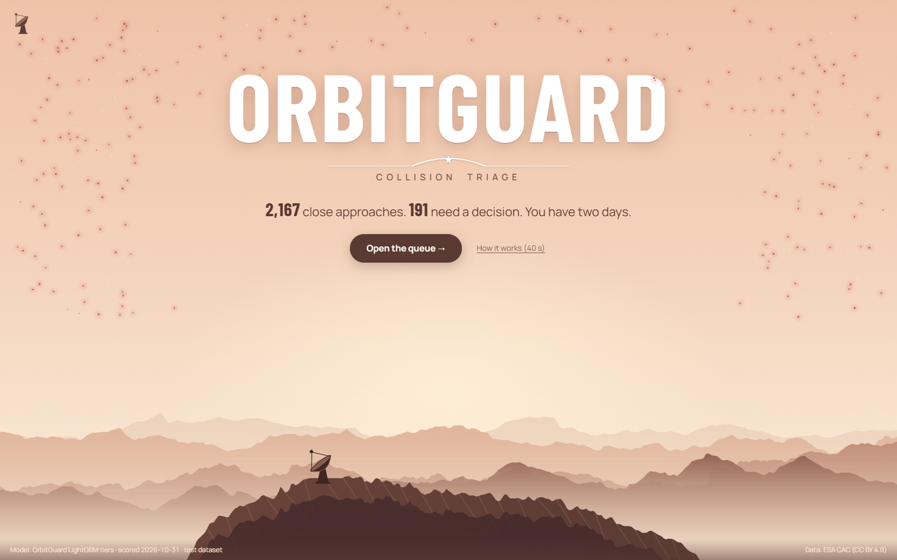
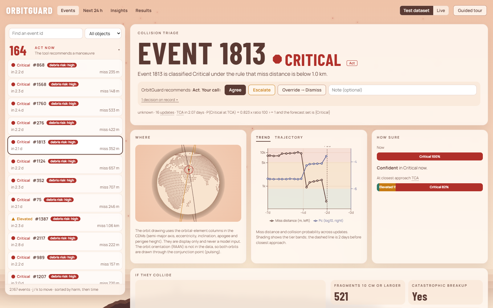
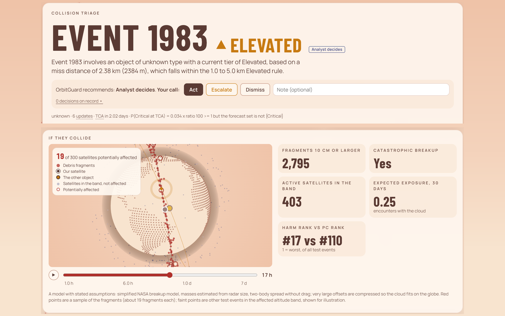
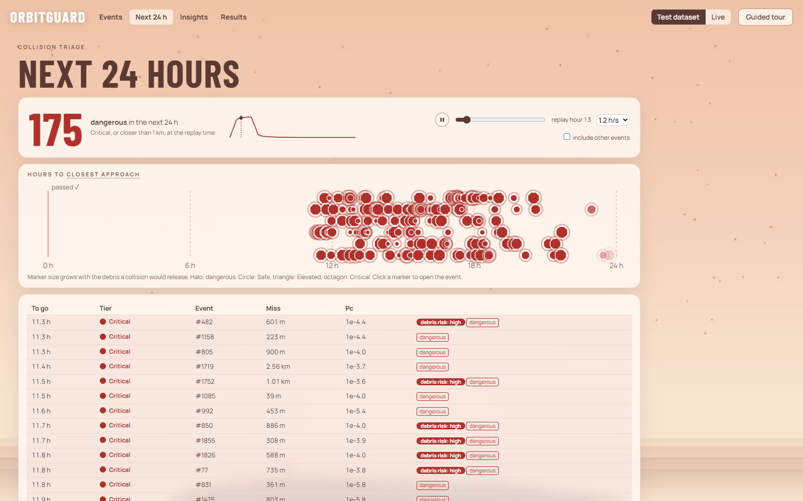
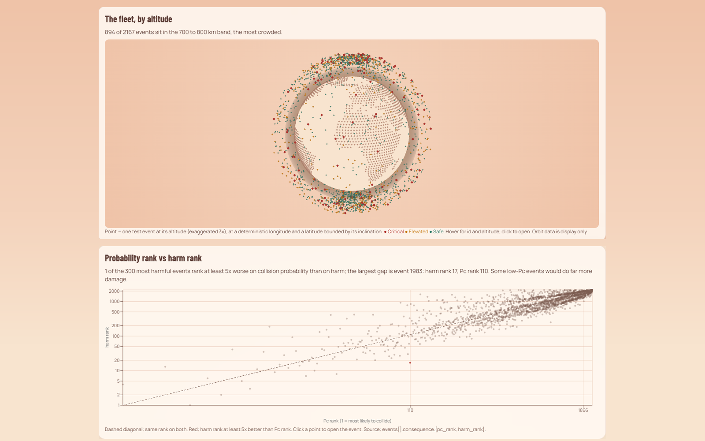
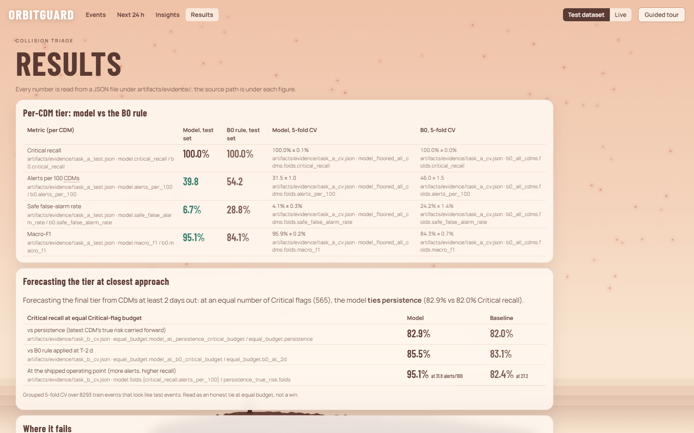
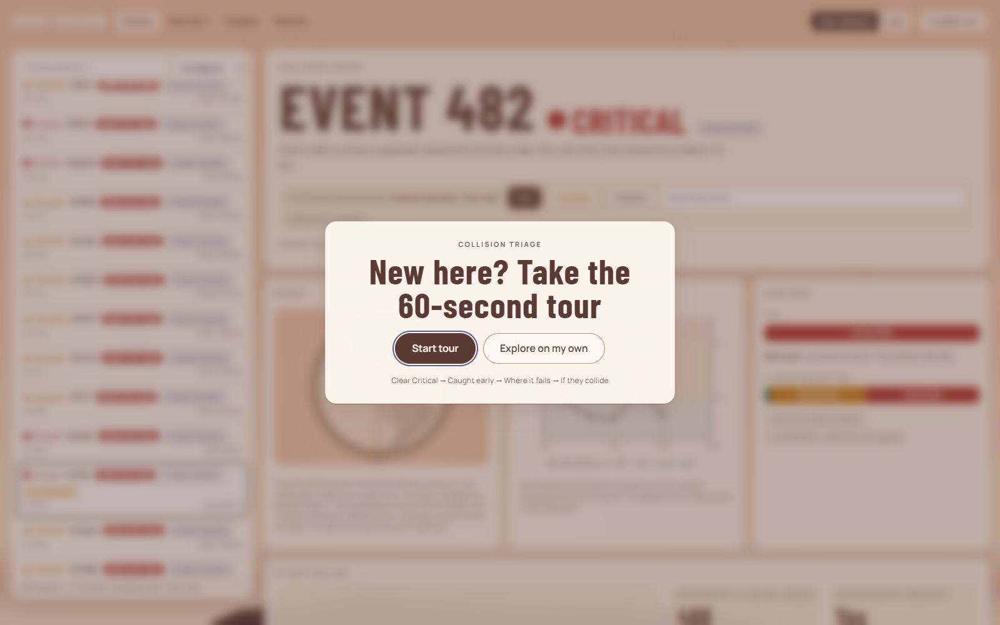
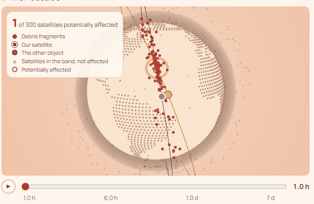
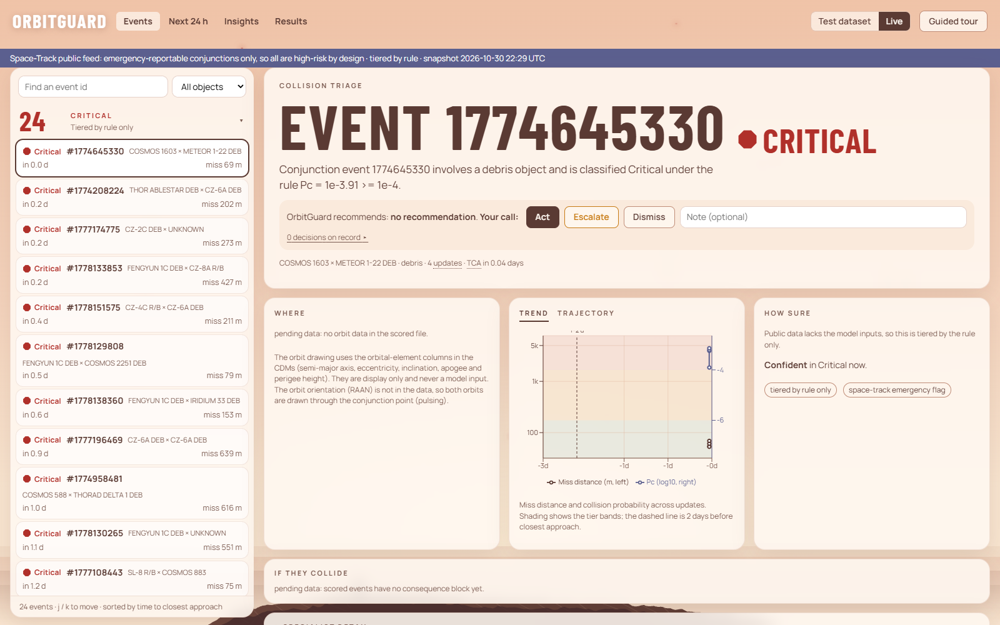

# OrbitGuard: collision triage for satellite operators

Autonomous SG 2026 (Acacia Hackathon Society x NUS Product Club) · AI & Aerospace track · **Airbus Challenge #1**

**Live demo: [og.ryash.dev](https://og.ryash.dev)** (if the team's backend is offline, it runs read-only from a bundled snapshot)

**Contents:** [Headline result](#headline-result-the-official-evaluation) · [Console](#the-console) ·
[Problem](#the-problem) · [Tiers](#risk-tiers) · [What it does](#what-it-does) · [Results](#results) ·
[Where it fails](#where-it-fails) · [Run it](#run-it) · [Deploy](#deploy) · [Submission](#submission-files) ·
[Data](#data) · [Limitations](#limitations) · [Repo map](#repository-map)

> Classifying one conjunction message is easy. Knowing **two days before closest approach** which events will
> still be dangerous, and knowing when you don't know, is the hard part. OrbitGuard reads conjunction data
> messages (CDMs), sorts every event into **Safe / Elevated / Critical (manoeuvre required)**, forecasts the tier
> at closest approach with a calibrated miss-rate guarantee, and hands uncertain events to the analyst. The
> analyst decides.



## Headline result: the official evaluation

The organisers' task: predict each event's **final tier** using only CDMs at least 2 days before closest approach,
evaluated on an **80/20 split of `train_data` by `event_id`**. The split is seeded and its holdout ids are saved
([`official_holdout_ids.json`](artifacts/evidence/official_holdout_ids.json)). Labels come from the organisers'
`challenge1_event_labels.xlsx`, which agrees with our own on all 13,154 events. Evidence:
[`official_holdout.json`](artifacts/evidence/official_holdout.json).

**20% holdout, 2,389 usable events (167 end Critical), scored once:**

| | Critical recall | Critical precision | Macro-F1 | Alerts / 100 events |
| --- | --- | --- | --- | --- |
| **OrbitGuard** | **0.952** (159 of 167) | 0.479 | 0.706 | 33.8 |
| Persistence (tier of the last CDM ≥ 2 d out) | 0.820 | **0.830** | **0.877** | 26.0 |
| `max_risk_estimate` rule at 2 d | 0.832 | 0.777 | 0.740 | 43.0 |

Confusion matrix, OrbitGuard (rows = true, columns = predicted):

| | → Safe | → Elevated | → Critical |
| --- | --- | --- | --- |
| **Safe** | 1,540 | 211 | 39 |
| **Elevated** | 40 | 258 | 134 |
| **Critical** | **1** | 7 | 159 |

- **What we trade.** We find 159 of 167 events that end Critical; persistence finds 137. The price is precision:
  OrbitGuard raises more Critical flags, so persistence wins on macro-F1. We chose recall on Critical deliberately,
  because a missed collision costs far more than a review, and we control the extra flags with abstention and a
  cost-aware decision layer (below).
- **Only 1 of 167** Critical events was called Safe.
- **Calibrated uncertainty.** Conformal tier sets, calibrated on the 80%, miss 3.6% of Critical events on the
  holdout (target ≤ 5%) and hand 19.8% of events to the analyst.
- **Spread across folds.** 5-fold grouped CV gives Critical recall 0.965 ± 0.021 (persistence 0.866 ± 0.032).
- **Harder subset.** On the holdout events whose final CDM is within a day of closest approach (how the test set
  was built), Critical recall is 0.955 vs persistence 0.764.

## The console

| | |
| --- | --- |
|  |  |
| **Event page.** Tier, the rule that fired, the recommendation and *your call*. Orbits, trend and how sure the model is. | **If they collide.** A simulated breakup: debris fragments, and the active satellites they could reach over 7 days. |
|  |  |
| **Next 24 hours.** The warnings view. Events slide toward closest approach as the replay clock runs. | **Insights.** Crowding by altitude, how tiers change after T−2 d, calibration, and Pc rank vs harm rank. |
|  |  |
| **Results.** Every number is read from an evidence file, and the file path is shown. Failure cases included. | **Guided tour.** Four stops: a clear Critical, one caught early, where it fails, and a costly collision. |



**Live mode** reads Space-Track's public CDM feed (emergency-reportable conjunctions only) and tiers it by rule,
because the public feed does not carry the model's inputs.



## The problem

**User.** A conjunction-assessment analyst on a LEO operator's flight-dynamics team. For every close approach
they receive a stream of CDMs (`cdms_per_event` in [`baselines.json`](artifacts/evidence/baselines.json)), and by roughly 2 days before the time of
closest approach (TCA) they must decide whether to start manoeuvre planning.

**Today.** Read each CDM, check Pc and miss distance against thresholds (NASA CARA, NASA/SP-20205011318; ESA
Space Debris Office practice), judge whether the covariance is credible, and watch the numbers drift. Most events
fade; a few get worse late.

**What that costs, measured on the ESA Collision Avoidance Challenge data** (8,293 training events that look like
the test set, [`baselines.json`](artifacts/evidence/baselines.json)):
- Acting on the 2-day view ("persistence") misses **99 of 551** events that end Critical.
- 113 events that look Critical at 2 days end lower (`persistence_false_critical`): unnecessary manoeuvres.
- In the 2019 ESA competition on this data, "copy the latest CDM" was a hard baseline to beat: the winning
  score was 0.556 against the baseline's 0.694 (Uriot et al., *Spacecraft collision avoidance challenge: design and
  results of a machine learning competition*, arXiv:2008.03069).

## Risk tiers

From the problem statement, implemented once in [ca_triage/tiers.py](ca_triage/tiers.py):

| Tier | Rule |
| --- | --- |
| Critical (manoeuvre required) | Pc ≥ 10⁻⁴ (risk ≥ −4.0), or miss distance < 1,000 m |
| Elevated | Not Critical, and 10⁻⁶ ≤ Pc < 10⁻⁴ or 1,000 m ≤ miss distance ≤ 5,000 m |
| Safe | Pc < 10⁻⁶ and miss distance > 5,000 m |

## What it does

| Step | What the analyst gets | Method |
| --- | --- | --- |
| Tier each CDM | Tier, the rule that fired, P(tier) | LightGBM on the 13 allowed columns, floored by the exact miss-distance rule |
| Forecast the tier at TCA | P(Critical at TCA) from CDMs ≥ 2 days out | LightGBM on event history features |
| Know when it doesn't know | A **set** of possible tiers. More than one tier → "Analyst decides" | Conformal risk control (Learn-then-Test), target Critical miss rate ≤ 5% |
| Flag unreliable inputs | `covariance_fragile`, `out_of_distribution`, placeholder sigmas | Encounter-plane Pc sweep over covariance scale; isolation forest; drift audit |
| Recommend | Act / Dismiss / Analyst decides, with a cost-ratio slider | Expected cost with C_miss / C_man (default 100) |
| Explain | A short brief per event | LLM restates computed facts; every number is checked, otherwise a template is shown |
| Account | Accept / Escalate / Dismiss with a note | Hash-chained audit log |

### Where AI is used, and where it deliberately is not

- **The tier rule is a fixed rule.** No model and no LLM decides a threshold.
- **Statistics and ML estimate** the Pc branch and the forecast, with calibrated sets and explicit abstention.
- **Physics** (encounter-plane Gaussian Pc) is a baseline and a fragility flag, with its assumptions written down
  ([ca_triage/physics.py](ca_triage/physics.py)).
- **The LLM only writes the explanation.** It never computes, ranks or decides. A numeric guard rejects any brief
  containing a number that is not a computed fact ([ca_triage/brief/guard.py](ca_triage/brief/guard.py)). The app
  works with no API key.
- **The analyst decides.** Every output is labelled as tool output and every action is logged.

## Results

Every number comes from a JSON file under [artifacts/evidence/](artifacts/evidence/) that a script wrote; the
console's Results page shows the source file under each figure. Details, tables and caveats:
[docs/RESULTS.md](docs/RESULTS.md).

- **Per-CDM tier, test CDMs** ([`task_a_test.json`](artifacts/evidence/task_a_test.json)): Critical recall 1.000 (0 of
  2,227 missed), 39.8 alerts per 100 CDMs vs 54.2 for the `max_risk_estimate` rule, macro-F1 0.951 vs 0.841.
- **Tier forecast, CV** ([`task_b_cv.json`](artifacts/evidence/task_b_cv.json)): at the same number of Critical flags
  the model ties persistence (0.829 vs 0.820). It does not beat it; we ship a recall-first operating point.
- **Conformal sets** ([`conformal.json`](artifacts/evidence/conformal.json)): miss 3.3% of Critical events in held-out
  folds (target ≤ 5%). On ESA's released test labels they missed 2 of 17 (11.8%), above target, reported as is.
- **Decision layer, cost ratio 100** ([`decision.json`](artifacts/evidence/decision.json)): missed Critical 0.22 vs
  1.19 per 100 events, at the price of 17.8 manoeuvres per 100 vs 6.8.
- **Consequence** ([`consequence.json`](artifacts/evidence/consequence.json)): ranking by expected harm instead of Pc
  moves 9 of the top 20 events by 5 or more places. Event 1983 ranks 110th by Pc and 17th by harm. Display and
  prioritisation only; it never changes the tier.

## Where it fails

From held-out folds ([`failure_cases.json`](artifacts/evidence/failure_cases.json)), shown in the console under
Results → Where it fails:
- **Late miss-distance collapse.** Events 8732, 11790, 11623 and 2958 look Safe at 2 days (P(Critical) < 0.1%) and
  end Critical when the miss distance collapses from 8–35 km to under 1 km in the last two days. Nothing in the
  allowed early CDMs predicts it. Event 8732 also has a placeholder covariance; 2958 has a single early CDM.
- **Borderline Pc.** Two Critical CDMs (events 1176, 11573) have Pc just above 10⁻⁴ and are scored Elevated.
- **What the analyst sees:** placeholder sigmas, single-CDM history and out-of-distribution inputs are flagged on
  the event, and those events go to "Analyst decides" instead of getting a confident tier.
- **Train/test drift is mild** (adversarial AUC 0.55, [`drift.json`](artifacts/evidence/drift.json)); 25 test events
  are out of distribution and are routed to the analyst.

Everything we tried and dropped is in [docs/EXPERIMENTS.md](docs/EXPERIMENTS.md).

## Run it

Needs Python 3.11+ and Node 20+.

```bash
python -m pip install -e ".[dev]"
python scripts/fetch_data.py      # dataset/ from the organisers' Drive folder
python -m pytest -q
python scripts/serve.py --with-web   # API + console on http://localhost:8000 (API only without the flag)
```

Rebuild every model and evidence file: `sh scripts/rerun_evidence.sh` (the two one-shot test scores are not re-run).
Model binaries are not committed. A retrain on a fresh clone is accepted only if its predictions match the reference
sample stored in the frozen [model card](artifacts/model_card.json) within 1e-6. LightGBM pickles are not
byte-identical across runs, so the file hashes can differ while the predictions match.
Optional: `ANTHROPIC_API_KEY` for LLM briefs, and `SPACETRACK_USER` / `SPACETRACK_PASS` for live mode. See
`.env.example`.

## Deploy

Static Vite front end on Vercel, FastAPI on the team's PC behind a Cloudflare Tunnel, and a bundled read-only
snapshot when the backend is off. Steps: [docs/DEPLOY.md](docs/DEPLOY.md).

## Submission files

- [submission/test_predictions.csv](submission/test_predictions.csv): one row per test CDM (`row` = 0-based row in
  `test_data.csv`, `event_id`, `time_to_tca`, `tier_pred`, `tier_name`, `p_safe`, `p_elevated`, `p_critical`, `rule`).
- [submission/test_event_forecasts.csv](submission/test_event_forecasts.csv): one row per test event with the forecast
  tier at TCA and its probabilities.

## Data

ESA Collision Avoidance Challenge dataset (CC BY 4.0), as distributed by the organisers. **Model inputs** are only the
allowed columns: `event_id, time_to_tca, miss_distance, relative_speed, relative_position_{r,t,n}, c_object_type,
c_sigma_r, t_sigma_r, max_risk_estimate, F10, AP`. `risk` (log10 Pc) is the label only.
The organisers allow other columns if explained. We use them only for display and consequence, **never as model
inputs** (a test checks it, [tests/test_features.py](tests/test_features.py)):
- Orbital elements (`*_j2k_sma/ecc/inc`, `*_h_apo/per`) draw the orbits.
- Radar cross-section and area-to-mass (`*_rcs_estimate`, `*_cd_area_over_mass`) give the mass proxies in the
  debris model.

Units: miss distance and relative position in metres, relative speed in m/s, `time_to_tca` in days. `event_id`
restarts in each file, so train and test are never joined on it. Official per-event labels come from
`challenge1_event_labels.xlsx` (fetched by `scripts/fetch_data.py`).

## Limitations

- Only radial sigmas are available, so the physics Pc assumes an isotropic covariance and a 10 m hard-body radius.
- Conformal guarantees assume test events resemble the calibration events; the drift audit shows a mild shift, and
  the test-set miss rate (2 of 17) was above target.
- The conformal CV reuses out-of-fold scores from models that saw the evaluation fold, so the CV coverage is
  slightly optimistic. The released-label test is the clean check.
- The released test labels have no final miss distance and only 17 Critical events.
- Live mode uses Space-Track public CDMs, which carry Pc and miss distance but not our other inputs, so live events
  are tiered by rule only.
- Decision support only. It never commands a spacecraft.

## Repository map

```
ca_triage/   tiers, data, models, physics, OOD, brief + guard, audit storage, FastAPI app
scripts/     fetch, evaluate, train, conformal, decision, freeze, predict, serve
web/         React + Vite console (landing, queue, event detail with globe, next 24 h, insights, results)
artifacts/   evidence/*.json (committed), scored/*.json (committed), model_card.json
submission/  test predictions
docs/        RESULTS, DEPLOY, DESIGN, PITCH, CONTRACT, EXPERIMENTS, REFERENCE_REPO_ANALYSIS
```

## Team

Team TripleT: Yash Raj, Bhavya Puri, Aslan Shaukat Vaida, Ramith Vaid.
